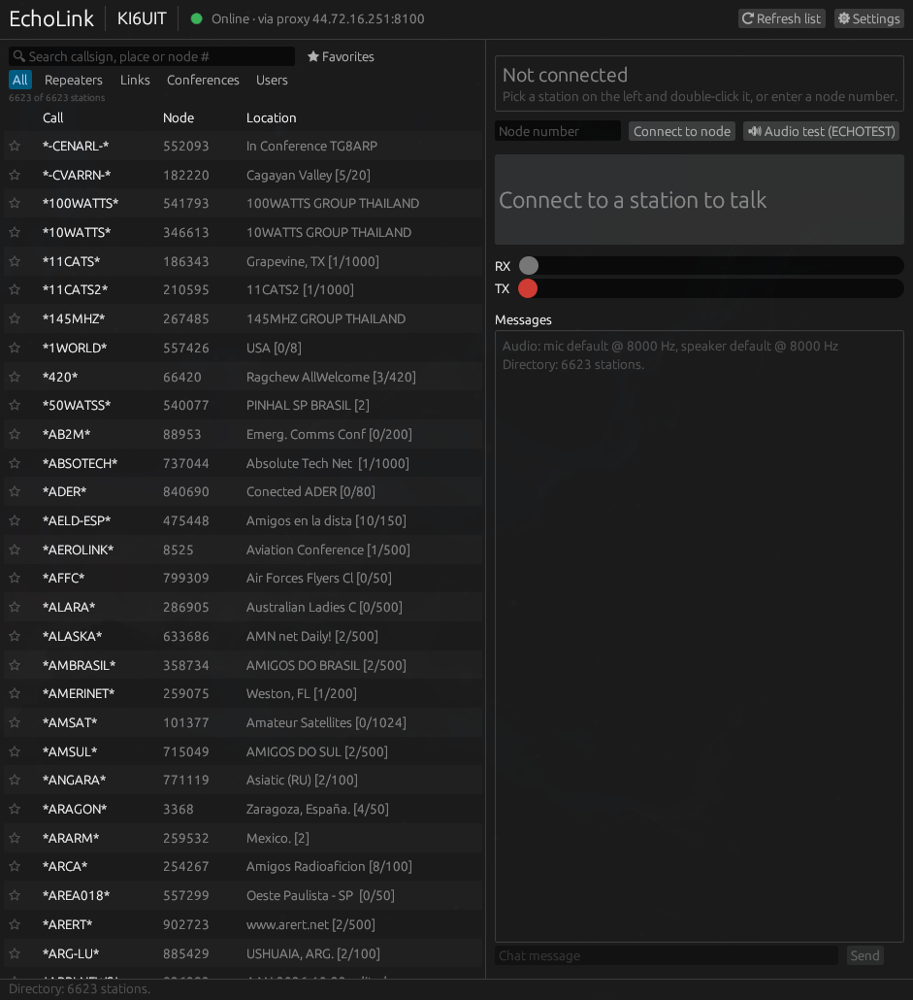

# echolink-tui

An EchoLink client for Linux, written in Rust, with two front ends on one engine:

- **`echolink-gui`**: a desktop app with a big push-to-talk button, a searchable station list
  with favorites, and a settings window. No terminal needed.
- **`echolink-tui`**: the same station in a terminal.



- Browse the live EchoLink directory: repeaters, links, conferences and users, with search
- Connect by picking a station or typing its node number
- Push-to-talk with the Space bar. You hold it in terminals that report key releases (Ghostty, Kitty, Alacritty, foot) and tap it on, then off, elsewhere
- Text chat, the far station's info text, and RX/TX level meters
- Accepts incoming connections while you're idle (can be turned off)
- 3-minute transmit limit, like a repeater time-out timer

## Requirements

- A callsign validated for EchoLink at <https://secure.echolink.org/validation/>.
  Use your personal callsign (e.g. `N0CALL`), not a `-R`/`-L` node callsign that a repeater
  or link is already logged in with.
- `gsm` (libgsm) and `alsa-lib`, both standard on Arch/Omarchy: `sudo pacman -S --needed gsm alsa-lib`
- Rust to build it (`mise use -g rust` or `rustup`)
- Either UDP ports **5198–5199** reachable from the internet (forward them to this computer
  on your router), or an **EchoLink proxy** (below). Starlink, cellular and other
  carrier-grade NAT connections can't forward ports, so they need the proxy.

## Install

```bash
cargo build --release
install -Dm755 target/release/echolink-gui ~/.local/bin/echolink-gui
install -Dm755 target/release/echolink-tui ~/.local/bin/echolink-tui
install -Dm644 packaging/echolink-gui.desktop ~/.local/share/applications/echolink-gui.desktop
install -Dm644 packaging/echolink-gui.svg ~/.local/share/icons/hicolor/scalable/apps/echolink-gui.svg
```

Then open **EchoLink** from your app menu. On first start it asks for your callsign,
password, name, location and connection type. For the terminal version, run
`echolink-tui setup` instead. Both use the same settings file.

To build only the terminal version (no GUI libraries), use `cargo build --release --no-default-features`.

### Desktop app

- Double-click a station, type a node number, or press **Audio test (ECHOTEST)**.
- Hold the big **Hold to talk** button, or hold **Space** while no text box is selected.
- Click ☆ to make a station a favorite. Favorites sort to the top, and the ★ Favorites
  button shows only them.
- ⚙ Settings changes your details or connection. The app restarts itself to apply them.
- Incoming calls and chat show a desktop notification when the window isn't focused.
- Closing the window disconnects and logs you off the directory.

`setup` asks for your callsign, name, location and password. The password is typed without
echo and saved in `~/.config/echolink-tui/config.toml` with permissions 600. You can also
leave it out of the file and set `ECHOLINK_PASSWORD` in the environment.

### Proxy

Set `proxy` in `~/.config/echolink-tui/config.toml`, or answer the question in `setup`:

```toml
proxy = "auto"                 # pick a Ready public proxy, nearest first
# proxy = "elp-51.w3kit.net"   # or a specific one (port 8100 unless you add :port)
# proxy_password = "secret"    # only for a private proxy; public ones use PUBLIC
```

The program then makes one outgoing TCP connection (port 8100) to the proxy, which logs in to
the directory and exchanges station traffic from its own public IP. Other stations see you
at the proxy's address. If the proxy drops, another is picked and you're logged in again
within about 10 seconds. Public proxies are listed at <https://www.echolink.org/proxylist.jsp>.

## Terminal version

```bash
echolink-tui              # full-screen client
echolink-tui list ala     # log in and print matching stations, e.g. everything in Alabama
```

| Key | Action |
|---|---|
| ↑ ↓ / j k, PgUp PgDn, g G | Move through the station list |
| Tab / Shift-Tab | All · Repeaters · Links · Conferences · Users |
| `/` | Search callsign, location or node number (Esc clears) |
| Enter | Connect to the selected station |
| `n` | Connect by node number |
| Space | Talk (hold, or tap on and off) |
| `c` | Send a chat message |
| `d` | Disconnect |
| `r` | Reload the station list |
| `q` / Ctrl-C | Disconnect, log off and quit |

Try `*ECHOTEST*` (node 9999) first. It plays back what you say.

Audio goes through the default PipeWire/ALSA microphone and speaker. Choose them in your
desktop's audio settings.

### When a call doesn't connect

Everything the program does (directory logins, each connection packet sent and received,
audio and chat) is logged to `~/.local/state/echolink-tui/activity.log`. Watch it with
`tail -f ~/.local/state/echolink-tui/activity.log`.

Nodes accept a connection only from an IP that's logged in to the EchoLink directory, and
some refresh their copy of the directory only every few minutes. If a node doesn't answer
right after you start the program, wait a minute and try again. If nothing ever connects,
check the UDP 5198–5199 forwarding.

## How it works

| Part | Protocol |
|---|---|
| Directory | TCP 5200 to `servers.echolink.org` and backups: log in, refresh every 5 min, fetch the list |
| Control | UDP 5199, RTCP SDES packets as hello and 10 s keepalive, BYE to hang up |
| Audio | UDP 5198, RTP with four GSM 06.10 frames (80 ms) per packet. `oNDATA` text packets carry info and chat |
| Proxy | TCP 8100: MD5 challenge login, then framed blocks carrying the directory TCP stream and both UDP ports |

The protocol details, including the proxy, follow [SvxLink's echolib](https://github.com/sm0svx/svxlink/tree/master/src/echolib)
and AllStarLink's [chan_echolink](https://github.com/AllStarLink/app_rpt/blob/master/channels/chan_echolink.c).

## Tests

```bash
cargo test                  # packet formats, directory parsing, GSM codec, resampler, proxy framing
ELPROXY_CALL=N0CALL cargo test live -- --ignored   # tunnel to the directory through a real public proxy
tests/run-peer-test.sh      # full call against a simulated station in a private network namespace
```

## License

GPL-2.0-or-later, the same as SvxLink, whose protocol code this follows. See [LICENSE](LICENSE).

EchoLink® is a registered trademark of Synergenix Interactive, LLC. This project isn't
affiliated with or endorsed by it.
